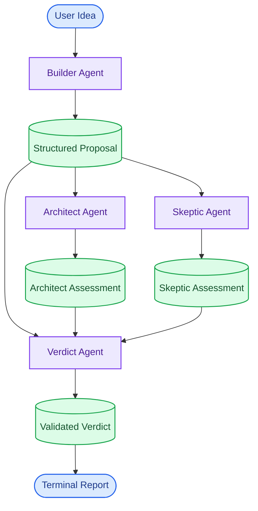

# Parallax

### Multi-Agent Proposal Analysis

Parallax transforms ideas into structured proposals, evaluates them through independent technical and critical assessments, and synthesizes the findings into a final verdict.

Built with Python, LangGraph, and Pydantic, Parallax coordinates four specialized AI agents through a graph-based workflow. The system combines structured data validation, parallel assessment, and verdict synthesis to provide a more systematic approach to evaluating ideas.

## Overview

Given an idea, Parallax performs four stages of evaluation:

- **Builder** — Converts the user's idea into a structured proposal with objectives, constraints, and success criteria.
- **Architect** — Evaluates technical feasibility, implementation complexity, and architectural risks.
- **Skeptic** — Challenges assumptions, identifies weaknesses, and examines potential failure scenarios.
- **Verdict** — Synthesizes the proposal and both assessments into a final decision with supporting reasoning and recommendations.

The final verdict can be `PROCEED`, `REVISE`, or `REJECT`, depending on the model's assessment of the available information.

## Architecture

Parallax uses **LangGraph** to coordinate the execution of its agents. After the Builder generates a proposal, the Architect and Skeptic evaluate it independently in parallel branches. The Verdict Agent executes only after both assessments are available.




## Key Features

- **Multi-agent orchestration:** Coordinates four specialized agents through a LangGraph workflow.
- **Parallel assessment:** Evaluates proposals through independent architectural and critical perspectives.
- **Schema validation:** Uses Pydantic to enforce expected fields, types, constraints, and permitted values in model-generated outputs.
- **Evidence-oriented analysis:** Structures findings around severity, explanations, evidence, assumptions, and recommendations.
- **Modular architecture:** Separates agent implementations, schemas, model configuration, workflow orchestration, and CLI presentation.
- **Readable CLI:** Presents proposals, assessments, and the final verdict in a structured terminal report.
- **Free-model compatibility:** Supports configurable OpenRouter model identifiers intended for free inference.


## Technology Stack

| Technology | Purpose |
|---|---|
| Python | Core application and agent logic |
| LangGraph | Workflow orchestration and shared state |
| Pydantic | Schema definition and response validation |
| OpenAI Python SDK | Chat completion client |
| OpenRouter | Language model access |
| pydantic-settings | Configuration management |
| pytest | Automated testing |
| Ruff | Linting and code quality |
| uv | Dependency and project management |

## Project Structure

```text
parallax/
├── src/
│   └── parallax/
│       ├── agents/
│       │   ├── builder.py
│       │   ├── architect.py
│       │   ├── skeptic.py
│       │   └── verdict.py
│       ├── llm/
│       │   └── client.py
│       ├── schemas/
│       │   ├── proposal.py
│       │   ├── assessment.py
│       │   └── verdict.py
│       ├── workflow/
│       │   ├── state.py
│       │   ├── nodes.py
│       │   ├── graph.py
│       │   └── runner.py
│       ├── config.py
│       └── cli.py
├── tests/
│   ├── agents/
│   │   ├── test_builder.py
│   │   ├── test_architect.py
│   │   ├── test_skeptic.py
│   │   └── test_verdict.py
│   ├── schemas/
│   ├── workflow/
│   │   └── test_graph.py
│   └── test_config.py
├── scripts/
│   ├── smoke_test_openrouter.py
│   ├── test_builder_live.py
│   ├── test_architect_live.py
│   ├── test_skeptic_live.py
│   └── test_verdict_live.py
├── .env.example
├── .gitignore
├── .python-version
├── pyproject.toml
├── uv.lock
└── README.md
```

- `agents/` contains the four specialized agent implementations.
- `schemas/` defines the validated data contracts used throughout the application.
- `workflow/` manages shared state, graph construction, execution nodes, and workflow orchestration.
- `llm/` provides the shared model client.
- `cli.py` handles user input and renders the final report.
- `tests/` contains automated unit tests organized by module; `scripts/` contains manual live-integration tests that run against the actual model API.

## Getting Started

### Prerequisites

- Python 3.13 or a compatible version supported by the project dependencies
- [uv](https://docs.astral.sh/uv/)
- An [OpenRouter](https://openrouter.ai/) API key

### 1. Clone the repository

```bash
git clone https://github.com/yuvraj-9999/parallax
cd parallax
```

### 2. Install dependencies

```bash
uv sync --dev
```

### 3. Configure environment variables

Create a `.env` file in the project root using `.env.example` as a reference.

```env
OPENROUTER_API_KEY=your_openrouter_api_key
OPENROUTER_MODEL=nvidia/nemotron-3-ultra-550b-a55b:free
```

`OPENROUTER_API_KEY` and `OPENROUTER_MODEL` are required. `OPENROUTER_BASE_URL` defaults to `https://openrouter.ai/api/v1` and does not need to be set unless you are routing through a different endpoint.

The model value must be either `openrouter/free` or an explicitly named model ID ending in `:free`. The configured example reflects the development setup and may need updating if that model becomes unavailable.

Keep your API key private. Never commit `.env` or hardcode credentials into source files.

### 4. Run Parallax

```bash
uv run python -m parallax.cli
```

Enter an idea when prompted. Parallax generates a proposal, runs both assessments, and displays the final verdict and recommendations in the terminal.

## Testing and Code Quality

Run the automated test suite:

```bash
uv run pytest -q
```

Run Ruff:

```bash
uv run ruff check .
```

The automated tests verify application behavior without depending on live model responses. Scripts in `scripts/` test actual model integration but consume the provider's free request quota and may be affected by rate limits or model availability.

## Design Principles

- **Separation of concerns:** Each agent and workflow component has a defined responsibility.
- **Explicit contracts:** Model-generated outputs must satisfy predefined Pydantic schemas.
- **Controlled execution:** LangGraph manages dependencies between assessment and verdict synthesis.
- **Failure visibility:** Invalid or incomplete responses are treated as failures rather than silently accepted.
- **Testability:** Core behavior can be tested independently of live model calls.

## Scope and Limitations

Parallax currently provides terminal-based proposal evaluation. It does not include a graphical interface, persistent evaluation history, authentication, or independent fact-checking.

Pydantic validation ensures that outputs conform to the expected structure. It does not verify factual accuracy, eliminate model bias, or guarantee that a verdict is correct. Final decisions are model-generated recommendations based on the available information.

## Future Scope

- **Iterative Evaluation:** Refine proposals using agent feedback.
- **Persistent History:** Store and compare previous evaluations.
- **Evidence Verification:** Validate claims using external information sources.
- **Dynamic Workflows:** Enable conditional routing and reassessment.
- **Evaluation Metrics:** Measure agent agreement and verdict consistency.
- **Web Interface:** Provide an interactive interface for exploring results.

